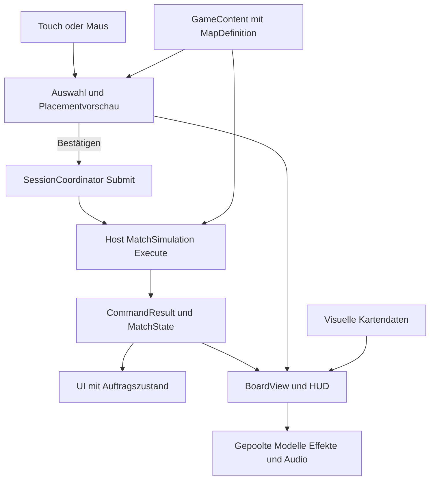

# Defense Duell Recherche zu Spielqualität Placement und Architektur

Stand: 10. November 2026. Für den Entwicklungs-Chat **Entwickle Defense Duell für Android** und den Nutzer. Grundlage sind die ursprüngliche Spielbeschreibung, die anschließend ausdrücklich gewünschten 3D-Karten und Goldminen, der aktuelle Projektcode sowie die unten verlinkten Forschungs- und Herstellerquellen.

**Späterer Nutzerauftrag am selben Tag:** Kampfgebäude sollen frei platziert werden. Die Umsetzung und Abnahme werden in [FreePlacementDesign.md](FreePlacementDesign.md) verfolgt. Aussagen dieses Berichts zu festen Kampfplätzen und die zugehörigen Messungen beschreiben die vorherigen Versionen; sie beschränken den neuen Auftrag nicht.

**Die stärkste nächste Verbesserung ist, vorhandene Entscheidungen verständlicher und wirksamer zu machen: Bauplätze vergleichbar zeigen, Angriffe lesbar vorbereiten und die starke Verteidigung im menschlichen Spiel prüfen.** Die Karten besitzen bereits erhebliche räumliche Unterschiede. Neue Regeln sind dafür nicht erforderlich. Dieser Bericht ergänzt die Bewegungs- und Feedbackspezifikation in [GameFeelResearch.md](GameFeelResearch.md).

## 1 Die Spielidee als feste Grundlage

Defense Duell bleibt ein privates, symmetrisches Duell: Beide Spieler verteidigen ihre eigene Basis und kaufen aus demselben Goldbudget Angreifer für den Gegner. Offline spielt ein regelgebundener Bot mit. WLAN und privater Online-Beitritt verwenden dieselbe Simulation.

Die gesicherte **Baseline 0.2 / Core v1.2** umfasst drei Karten, identische feste Wege für beide Seiten, zwölf feste Bauplätze einschließlich höchstens zwei Goldminen, vier Kampftürme und vier Angriffsklassen. Es gibt zwei Upgrades pro Gebäude, 65 Prozent Verkaufserlös, passives Einkommen und ein Acht-Minuten-Limit. Die ergänzte 3D-Darstellung ändert diese Regeln nicht. Verbindliche Details stehen in [Gameplay.md](Gameplay.md), [CONTRACT.md](CONTRACT.md) und [ARCHITECTURE.md](../ARCHITECTURE.md).

**Neuere, direkt geprüfte Nutzeraufträge:** Im Chat „Maps plastischer gestalten“ wurden größere Maps und mehr Turmplätze verlangt; die Entwicklung arbeitet dafür an 1600 × 960 Einheiten und 32 Plätzen. Im Chat „Finde Assets fürs Handyspiel“ wurden Drag-and-drop und wiederholt sofort bezahlte Truppenkäufe mit automatischem begrenztem FIFO-Ausmarsch ausdrücklich gewünscht. Im anschließend gelesenen Feedback-Chat wurden eigene Minenplätze verlangt sowie Kill-Gold bei weniger passivem Einkommen zur Umsetzung und Prüfung vorgeschlagen. Die Entwicklung trennt dafür Core v1.4 mit FIFO von einer v1.5-Wirtschaftsvariante. Die neue Kartendefinition enthält 30 Kampfplätze und zwei Minenplätze. Diese späteren Nutzeraufträge sind von den Rechercheempfehlungen und der ursprünglichen Baseline zu unterscheiden; der symmetrische 1v1-Kern bleibt bestehen. Abschnitt 4 misst alte und neue Geometrie getrennt.

Die Empfehlungen behalten diesen Rahmen bei. Dynamische Wegblockierung, verschiebbare Kampfgebäude, Bonusfelder, Wetter mit Kampfwerten, neue Helden oder ein wachsendes Einkommen durch Truppenkäufe sind **keine Bestandteile dieses Vorschlags**. Solche Mechaniken wären eigenständige Designänderungen. Visuelles Gelände darf insbesondere keine Deckung, Höhenboni oder Sichtblockaden versprechen, die der Spielkern nicht berechnet.

## 2 Woran Erfolg hier erkennbar wird

Für dieses kostenlose Spiel unter Freunden bedeutet Erfolg zunächst: Ein Freund kann einsteigen, versteht seine Entscheidungen, erlebt eine faire spannende Partie und möchte freiwillig eine Revanche. Eine spätere große Veröffentlichung hätte zusätzlich Aufgaben wie Auffindbarkeit, Reichweite und langfristige Betreuung. Der gegenwärtige Auftrag braucht dafür weder Monetarisierung noch tägliche Belohnungen oder einen Live-Service.

Die Forschung von Ryan, Rigby und Przybylski umfasst vier Studien. Wahrgenommene Kompetenz und Selbstbestimmung hängen dort mit Spielvergnügen zusammen; in der Multiplayer-Befragung kommt soziale Verbundenheit hinzu. Das stützt drei passende Designziele: eigene Strategien wählen können, deren Wirkung verstehen und sinnvoll miteinander spielen. Es beweist weder eine bestimmte Retention-Steigerung noch den Markterfolg einer einzelnen Mechanik. [Originalpublikation, 2006](https://selfdeterminationtheory.org/SDT/documents/2006_RyanRigbyPrzybylski_MandE.pdf)

GameFlow bietet ein weiteres Raster für die Prüfung von Spielerleben. Die Rückschau seiner Autorin untersucht über 200 Anwendungen des Modells. Solche Heuristiken helfen beim Strukturieren von Playtests; sie ersetzen keine Beobachtung dieses Spiels. [Sweetser, GameFlow 2020, Publikationsabstract](https://researchportalplus.anu.edu.au/en/publications/gameflow-2020-15-years-of-a-model-of-player-enjoyment/)

Für Defense Duell lassen sich daraus sechs konkrete Prüffragen ableiten:

| Erfolgsfaktor | Im Spiel sichtbar durch | Im Test beobachten |
| --- | --- | --- |
| Verständlicher Einstieg | Einmal bauen, Wirkung sehen, einmal senden | Erste gültige Platzierung ohne fremde Erklärung; Unterschied eigenes/gegnerisches Feld verstanden |
| Wirksame Entscheidungen | Klasse, Bauplatz, Upgrade, Angriff oder Mine konkurrieren um Gold | Spieler kann erklären, warum er gerade diese Aktion gewählt hat |
| Lesbare Konsequenzen | Reichweite, Rüstung, Frost und Basisschaden eindeutig | Niederlagen werden mit einer Spielentscheidung erklärt, nicht mit unklarer Bedienung |
| Spannung und Gegenmaßnahmen | Aufrüsten, gezielt senden, Ausgaben des Gegners ausnutzen | Reale Reaktionen auf gegnerische Entscheidungen; keine lange Folge wirkungsloser Käufe |
| Verlässliche Bedienung | Große Tippflächen, Vorschau, eindeutige Bestätigung | Fehlkäufe, doppelte Bestellungen und Verwechslungen zwischen Vorschau und Kauf |
| Soziales Wiederholen | Verständliches Ergebnis, funktionierende Revanche | Beide wollen freiwillig erneut spielen und eine andere Entscheidung ausprobieren |

Diese Punkte sind eine projektspezifische Ableitung. Viele Klicks, eine lange Sitzung oder eine hohe Bot-Siegquote sind für sich genommen kein Spielspaßnachweis.

## 3 Was andere Defense Spiele beitragen

Die folgenden Vergleiche beruhen auf offiziellen Spielbeschreibungen, Entwicklerhinweisen und George Fans Originalvortrag. Sie sind keine eigenen Langzeit-Spieltests. Die Steam-Seiten zeigten beim Abruf für Bloons TD 6 97 Prozent positive englischsprachige Rezensionen bei 232.601 Bewertungen, für Kingdom Rush 96 Prozent bei 4.968 und für Battles 2 83 Prozent bei 24.866. Diese Momentaufnahmen belegen große bzw. positiv bewertete Spielerschaften auf dieser Plattform; sie erklären weder Umsatz noch die Ursache des Erfolgs. [Bloons TD 6](https://store.steampowered.com/app/960090/Bloons_TD_6/), [Kingdom Rush](https://store.steampowered.com/app/246420/Kingdom_Rush___Tower_Defense/), [Battles 2](https://store.steampowered.com/app/1276390/Bloons_TD_Battles_2/)

| Referenz | Dokumentierte Eigenschaft | Übertragung auf Defense Duell |
| --- | --- | --- |
| **Bloons TD Battles 2** | Angriff und Verteidigung müssen gleichzeitig geplant werden; das Sendesystem verbindet dort Angriff und Wirtschaft. | Der gemeinsame Geldtopf erzeugt bereits den richtigen Entscheidungskonflikt. Kosten, Ausmarschtempo und ausstehende Truppen gut erklären. Das andere Einkommensmodell nicht übernehmen. [Herstellerbeschreibung](https://store.steampowered.com/app/1276390/Bloons_TD_Battles_2/) |
| **Bloons TD 6** | Unterschiedliche Türme, Upgradepfade und viele handgestaltete Karten. | Vorhandene vier Kampftürme mit klaren Rollen und sichtbaren Verbesserungen ausarbeiten. Jede unserer drei Karten soll andere Platzierungsentscheidungen ermöglichen. Die Menge an Türmen, Metaprogression und Spielmodi ist kein sinnvolles Ziel für diesen Umfang. [Herstellerbeschreibung](https://store.steampowered.com/app/960090/Bloons_TD_6/) |
| **Kingdom Rush** | Turmspezialisierungen, unterschiedliche Umgebungen, Verstärkung und direkte Befehle an Soldaten. | Eine überschaubare Zahl verständlicher Werkzeuge kann verschiedene taktische Situationen tragen. Umgebungsdetails helfen der Wiedererkennung. Helden, Soldatensteuerung und Zauber würden unseren Umfang verändern. [Ironhide auf Steam](https://store.steampowered.com/app/246420/Kingdom_Rush___Tower_Defense/) |
| **Kingdom Rush Battles** | Zwei gespiegelte Felder; Türme werden durch Antippen verfügbarer Plätze und Auswahl gebaut. Dazu kommen eigene Helden-, Booster- und Kartensysteme. | Feste Slots sind auch für direktes PvP eine plausible Bedienbasis. Zusätzliche Eingaben können darauf aufsetzen. Dieser Vergleich belegt die Bedienmechanik, keinen hier gemessenen Markterfolg. [Offizieller Einsteigerleitfaden, 3. November 2025](https://support.ironhidegames.com/support/solutions/articles/4000223620-kingdom-rush-battles-beginners-guide) |
| **Plants vs. Zombies** | George Fan beschreibt Lernen durch Handeln, zeitlich verteilte Einführung und verständliche visuelle Rollen. Die Sonnenblumen-Wirtschaft brauchte gezielte Vermittlung. | Erst Bauen und Angriff erklären, dann Upgrades und Minen. Die Mine verdient eine konkrete Erklärung ihrer verzögerten Wirkung. Bestehende Tutorialschritte an akzeptierten Aktionen festmachen. [GDC-Originalfolien, 2012](https://media.gdcvault.com/gdc2012/slides/Design%20Track/Fan_George_How%20I%20Got.pdf) |
| **Infinitode 2** | Der Entwickler dokumentiert sichtbare Turmstatistiken, Erklärungen in Menüs sowie räumlich wirkende Modifikatoren. | Auswirkungen eines Upgrades direkt vergleichen und vorhandene räumliche Synergien sichtbar machen. Nachbarschaftsboni und Forschungsbäume bleiben außerhalb unseres Vorschlags. [Entwicklerbericht zu Version 1.9.0, 2024](https://blog.infinitode.prineside.com/2024/07/infinitode-2-major-update-190-and.html) |

**Gemeinsame Designableitung:** Tiefe entsteht, wenn eine begrenzte Auswahl unter wechselnden Umständen unterschiedliche gute Antworten erlaubt. Die Spieloberfläche muss diese Umstände erkennbar machen. Die Fallbeispiele liefern Anregungen; ein erfolgreicher Titel allein beweist keine kausale Erfolgsformel. BTD4 bleibt die vom Nutzer gewünschte visuelle Orientierung; neuere Bloons-Titel dienen hier zusätzlich als dokumentierte Systemvergleiche.

## 4 Was die Baselinekarten bereits leisten

Die geometrische Analyse las die damaligen Karten und Reichweiten aus `Assets/Content/Standard.asset`, SHA-256 `f22b2e2c9be5e3e131e5d4532312733b96f93ff485f667673882d1c0492f7e34`. Für drei Karten, zwölf Plätze, vier Kampftürme und drei Stufen entstehen **432 Kombinationen**. Die Kreis-Segment-Schnittberechnung wurde jeweils mit einer unabhängigen Abtastung in höchstens 0,5 Wegeinheiten verglichen. Die Eingaben wurden als Baseline eingefroren. Es wurden keine Unity-Spielregeln durch diese Analyse geändert.

| Karte | Kürzeste Abdeckung Schnellfeuer Stufe 1 | Längste Abdeckung | Ungebremster Läufer im Radius, kumuliert |
| --- | --- | --- | --- |
| Grünes Tal | Slot 4: 120 Einheiten | Slot 9: rund 637 Einheiten | etwa 1,85 gegenüber 9,80 Sekunden |
| Sonnenpass | Slot 2: rund 190 Einheiten | Slot 9: rund 668 Einheiten | etwa 2,93 gegenüber 10,28 Sekunden |
| Frosthafen | Slot 8: rund 237 Einheiten | Slot 4: rund 576 Einheiten | etwa 3,65 gegenüber 8,86 Sekunden |

Die Nummerierung entspricht `BuildSlots` plus eins. Die Sekunden sind **geometrische Kontaktzeiten für einen ungebremsten Läufer mit Tempo 65**, keine garantierte Schussdauer. Zielwechsel, Abklingzeiten, Rüstung, Frost, andere Türme und vorzeitige Tode sind nicht eingerechnet. Der Core rundet außerdem Weglängen und Positionen; die kontinuierliche Geometrie ist eine Näherung an den tatsächlichen diskreten Kampf.

Im Grünen Tal deckt Slot 6 beim einfachen Schnellfeuerturm etwa 494 Wegeinheiten in **zwei getrennten Besuchen** ab. Slot 9 umfasst etwa 637 in einem zusammenhängenden Besuch. Damit können auch Verlauf und Zeitpunkt der Abdeckung eine Rolle spielen. Ein Platz nahe der Basis erfüllt eine andere Aufgabe als frühes Beschießen. Die größte Gesamtlänge ist deshalb kein automatisch bester Platz.

Der räumliche Hebel ist bereits deutlich. Auch beim beauftragten Ausbau auf 32 Plätze sollte die Platzierung die tatsächlich im Radius liegenden Wegstücke zusätzlich zum Ring zeigen. Für die Spieler reichen meist diese Markierungen; eine Prozentzahl oder ein scheinbar exakter Schadensscore würde zusätzliche Scheingenauigkeit erzeugen.

Auch das Angriffstempo verdient Aufmerksamkeit: Ohne Frost und Kampf braucht ein Sprinter je nach Karte ungefähr 20,9 bis 23,4 Sekunden bis zur Basis, ein Tank 64,9 bis 72,6 Sekunden. Das ist ein erheblicher Planungshorizont. Ein Sende-ACK bestätigt den Auftrag sofort, während die Gegneransicht seine spätere Entwicklung sichtbar macht. Eine Anzeige darf diese reine Reisezeit nicht als garantierte Einschlagszeit ausgeben.

Reproduzierbare Belege: [Analyseprogramm](ResearchEvidence/analyze_placement.py), [Baselinezahlen als CSV](ResearchEvidence/placement-baseline-v02.csv), [eingefrorene Eingaben, Methode und SHA-256 als JSON](ResearchEvidence/placement-baseline-v02.json). Aufruf für aktuelle Inhaltsdaten: `python3 Docs/ResearchEvidence/analyze_placement.py`; die Ausgabe heißt `placement-current`. Die Baseline lässt sich mit `--from-evidence Docs/ResearchEvidence/placement-baseline-v02.json --prefix placement-baseline-recheck` unabhängig von späteren Änderungen nachrechnen.

**Nachmessung der neuen Karten:** Die inzwischen vorhandene `MapCatalog.cs` wurde mit den unveränderten Turmreichweiten und Geschwindigkeiten der Baseline ausgewertet. Das sind Geometriebefunde aus einer eingefrorenen Quelldatei, kein Nachweis für einen bereits integrierten oder auf Android geprüften Build. Alle Platznummern im Bericht sind einsbasiert; der C#-Katalog verwendet nullbasierte Indizes.

| Neue Karte | Kampf-/Minenplätze | Minenplatznummern | Weglänge; Faktor zur Baseline | Reisezeit Sprinter / Tank | Schnellfeuer Stufe 1: kürzeste / längste Abdeckung |
| --- | --- | --- | --- | --- | --- |
| Grünes Tal | 30 / 2 | 1, 30 | 4.532; 1,89× | 39,4 / 122,5 s | Platz 18: 184; Platz 23: 612 Wegeinheiten |
| Sonnenpass | 30 / 2 | 24, 28 | 4.122; 1,70× | 35,8 / 111,4 s | Platz 29: 187; Platz 22: 450 Wegeinheiten |
| Frosthafen | 30 / 2 | 1, 32 | 4.038; 1,50× | 35,1 / 109,1 s | Platz 10: 187; Platz 26: 421 Wegeinheiten |

Die **1.080 zulässigen Kombinationen** aus drei Karten, 30 Kampfplätzen, vier Kampftürmen und drei Stufen wurden analytisch berechnet und unabhängig durch Abtasten geprüft. Kein Kampfplatz hat beim einfachen Schnellfeuerturm null Wegabdeckung. Auf Minenplätzen wird keine illegale Turmabdeckung als Bauoption ausgewiesen; ihre Typen stehen gesondert im JSON. Im Grünen Tal erreicht der beste geometrische Schnellfeuerplatz ungefähr 3,32-mal die Abdeckung des schwächsten. Das ist ein sinnvoller Unterschied für die Vorschau, noch kein Nachweis einer optimalen Strategie.

**Wichtiger Tempobefund:** Ein ungebremster Tank braucht nun je nach Karte ungefähr 109 bis 122 Sekunden bis zur Basis statt zuvor 65 bis 73. Auch die schnellste Klasse braucht ungefähr 35 bis 39 Sekunden. Größere Maps verändern damit den Rückkopplungsabstand zwischen Angriff und Ergebnis erheblich. Bei einem Acht-Minuten-Limit muss die Entwicklung Angriffsankunft, wirkungslose Käufe und Timeoutquote separat prüfen. Die zusätzlichen Kampfplätze erhöhen zudem den möglichen Verteidigungsausbau. Aus der Geometrie allein folgt weder eine pauschale Geschwindigkeitserhöhung noch eine Einkommenssenkung.

Belege: [neue Karten als CSV](ResearchEvidence/placement-32slot-candidate.csv), [Quelldatei-Hash, Slottypen und Eingaben als JSON](ResearchEvidence/placement-32slot-candidate.json). Aufruf: `python3 Docs/ResearchEvidence/analyze_placement.py --catalog Assets/Core/MapCatalog.cs --prefix placement-32slot-candidate`. Die Ausgabe konserviert die tatsächlich gelesenen Koordinaten; spätere Änderungen brauchen eine neue Messung.

**Bildschirmabnahme:** 1600 × 960 gegenüber 1000 × 600 bedeutet 2,56-mal so viel logische Fläche. Bei identischem Bildausschnitt auf dem Handy schrumpft ein unverändert großes Weltobjekt auf 62,5 Prozent seiner bisherigen Bildschirmgröße. Das sind geometrische Skalierungsverhältnisse, keine gemessenen Ergebnisse des neuen Builds. Ein größeres Hauptspielfeld, geeignete Kameraführung oder ein ruhiger Fokusmodus müssen deshalb die Erkennbarkeit sichern. Alle 32 Plätze brauchen eindeutig wählbare Bildschirmpositionen; Weltgröße allein macht sie nicht besser bedienbar. Bestehende Reichweiten und Gegnergeschwindigkeiten nicht automatisch mitskalieren.

## 5 Placement als verständliche Interaktion

Im Code existieren bereits feste Slotflächen, ein Modell zur Vorschau, ein Reichweitenring, Kaufbestätigung, Upgrade, Verkauf und Fehlertexte. Die sinnvolle Aufgabe ist deren Verfeinerung. Folgender Ablauf erhält sämtliche Regeln:

1. **Gebäude wählen.** Preis und Rolle stehen direkt an der Auswahl. Ein Gebäude bleibt für die Vorschau auswählbar, auch wenn gerade Gold fehlt.
2. **Bauplatz auswählen.** Vorschau sitzt exakt auf dem Slot. Reichweite liegt auf derselben logischen Ebene wie der Weg; die darin liegenden Wegstücke werden markiert. Der Rest der Karte bleibt lesbar.
3. **Entscheidung prüfen.** Gebäude, Preis und verfügbarer Goldbestand sind sichtbar. Bei einer Mine steht dort Ertrag statt Kampfreichweite. Bei einem Upgrade erscheinen alte und neue Werte nebeneinander.
4. **Bestätigen oder abbrechen.** Erst Bestätigen erzeugt den Kaufbefehl. Ein Wechsel der Klasse oder des Slots kostet nichts. Zurück hebt zuerst die Auswahl auf.
5. **Auftragszustand anzeigen.** Die Eingabe reagiert lokal sofort; der Kauf bleibt ausstehend, bis der Host antwortet. Annahme, Ablehnung und verbindlicher Spielzustand sind unterscheidbar.

**Beauftragtes Drag-and-drop als zusätzlicher Bedienweg:** Ein Turmsymbol wird auf einen festen Bauplatz gezogen. Die Vorschau rastet ein. Eine mögliche erste Variante lässt Loslassen den Platz wählen und verwendet die vorhandene Kaufbestätigung. Direkter Kauf beim gültigen Loslassen ist eine ebenfalls sinnvolle Testvariante, wenn Preis, Ziel und Abbruch ausreichend eindeutig sind; die UI-Entwicklung entscheidet anhand von Fehlkäufen und Bedienfluss. Die Tippfolge bleibt vollständig nutzbar. Für den Finger verdeckte Vorschauen hilft ein leicht versetztes Geistermodell mit eindeutig markiertem tatsächlichem Slot. Kein bestehender Turm wird dadurch im Match verschoben.

Ein Pointer-Wechsel, abgebrochener Touch, Menüwechsel, Hintergrundwechsel oder das Ziehen auf die Gegneransicht verwirft die Vorschau. Ein Drag darf nicht zusätzlich den Click-Pfad auslösen. Bei laufender Kaufbestätigung sind versehentliche Wiederholungen am selben Ziel zu sperren; andere zulässige Aktionen bleiben erreichbar. Unterschiedliche Request-IDs sind für den Host unterschiedliche Käufe, daher ersetzt seine Idempotenzprüfung keine Bedienlogik gegen Doppeltippen.

Für Upgrades etwa beim Schnellfeuer konkret zeigen: Schaden **6 → 9**, Reichweite **150 → 165**, Intervall **0,40 → 0,35 s**, Kosten **55 Gold**. Neue Reichweite kann als zweite Kontur erscheinen. Nicht pauschal einen prozentualen Gesamtschadensgewinn versprechen: Rüstung und Zielwechsel beeinflussen das Ergebnis. Beim Verkauf ist der tatsächliche abgerundete Erlös sichtbar.

Google empfiehlt mindestens 48 × 48 dp für Touchziele. Die vorhandenen 64 Einheiten in einem Unity-Canvas sind dadurch noch kein physischer 48-dp-Nachweis. Auf dem Zielgerät mit Skalierung und Safe Area prüfen; bei eng projizierten Slots eindeutige nächstgelegene Auswahl und eine klar sichtbare Vorschau sicherstellen. [Android-Entwicklerdokumentation](https://developer.android.com/guide/topics/ui/accessibility/views/apps-views)

## 6 Interaktive Maps ohne zusätzliche Kampfregeln

Interaktivität hat hier zwei sinnvolle Aufgaben: relevante Informationen aufdecken und auf tatsächliche Aktionen reagieren. Rein dekorative Reaktionen dürfen zusätzlich Charakter geben, sollten aber die Kauf- und Kampfbefehle nicht überlagern.

| Karte | Konkreter Vorschlag | Nutzen und Grenze |
| --- | --- | --- |
| Grünes Tal | Beim Auswählen werden die abgedeckten Abschnitte der Serpentinen hervorgehoben; Büsche am gebauten Fundament reagieren kurz. | Mehrfachkontakt und Bauwirkung werden sichtbar. Vegetation verdeckt keine Einheiten und verschiebt keine Tippfläche. |
| Sonnenpass | Felsbögen, Fahnen und Canyonränder gliedern den bestehenden Weg; Staub erscheint lokal beim bestätigten Bau. | Der kompliziertere Verlauf bekommt Orientierungspunkte. Dekorhöhe erzeugt weder Reichweitenbonus noch Sichtblockade. |
| Frosthafen | Ufer und Pfähle strukturieren den See; Eisdekoration reagiert dezent auf die Auswahl eines Frostturms. | Thematische Wiedererkennung. Der feste Boden bremst niemanden; eine wirkliche Verlangsamung wird ausschließlich an betroffenen Einheiten gezeigt. |
| Alle Karten | Angetippte Gebäude zeigen Rolle, Stufe und Reichweite; Antippen eines unkritischen Dekorobjekts kann eine kleine einmalige Reaktion auslösen. | Erkundung und Rückmeldung ohne neue Ressourcen. Dekorinteraktion hat bei aktiver Platzierung keine Eingabepriorität. |
| Beide Spielfelder | Klar benannte Umschaltung zwischen eigener Verteidigung und gegnerischer Übersicht; HP und lokale Bedrohung bleiben sichtbar. | Beobachten unterstützt den Zeitpunkt von Angriffen. Auf der Gegnerkarte ist kein eigener Bau möglich. |

Das Kapitel beschreibt eine geeignete Ausbaurichtung, keine Pflicht zu allen Effekten. Zuerst Reichweiteninformation und Auswahl fertigstellen, dann je Karte einen kleinen charakteristischen Akzent. Gemeinsam mit [GameFeelResearch.md](GameFeelResearch.md) verhindert das konkurrierende Animationen auf denselben Objekten. Exakte Treffer- oder Todesreaktionen benötigen echte Ereignisse; das Verschwinden einer Einheit allein reicht nicht zur Unterscheidung von Tod und Entkommen.

**Beauftragte Kartengestaltung im selben Regelrahmen:** Bei neuen handgefertigten Wegen zuerst unterschiedliche räumliche Aufgaben entwerfen: früher Kontakt, längere zusammenhängende Abdeckung, erneuter Kontakt und letzte Absicherung. Danach die vereinbarten 32 Plätze anordnen, mit allen Klassen und Stufen vergleichen und auf beiden Seiten identisch übernehmen. Erst anschließend Landschaft bauen. Die Baselineanalyse identifiziert Kandidaten für Spieltests, sie rechtfertigt noch kein automatisches Umsetzen der schwächsten Plätze.

**Minenplätze sauber versionieren:** In der Baseline geben Minen auf jedem erlaubten Platz denselben Ertrag und verbrauchen einen möglichen Verteidigungsplatz. Der spätere ausdrückliche Nutzerwunsch führt stattdessen zu zwei eigenen Minenplätzen. Damit entfällt diese räumliche Konkurrenz; die Entscheidung zwischen sofortigem Angriff, Verteidigung und späterem Einkommen bleibt über das gemeinsame Gold erhalten. Eigene Sockel und Erzdekoration können die erlaubten Standorte nun sinnvoll zeigen. Ein zusätzlicher Ertragsbonus durch Gelände ist weiterhin nicht vorgesehen. Auswahl, Vorschau und Hostvalidierung müssen denselben Slottyp verwenden.

## 7 Angriff Wirtschaft und Spannung prüfen

Die dokumentierten 72 Karten-Botpartien erreichten sämtlich 480 Sekunden. Auch reine Verteidigung konnte in einer früheren Versuchsreihe häufig ein Remis halten. Das ist ein ernstzunehmender Hinweis auf defensive Partien oder unzureichenden Angriff durch die getesteten Bots. Es ist **kein Beweis**, dass Menschen keine wirksamen Angriffe finden. Die ursprüngliche HP-Erhöhung erzeugte dominanten Tank-Spam und wurde richtigerweise verworfen. [Projektmessungen](Gameplay.md)

Die Balance sollte mit gezielten Situationen geprüft werden: Schwarm gegen teuren Einzelschaden, Tank gegen Schnellfeuer, gemischter Angriff gegen aufgerüstete Verteidigung, Angreifen während einer Mineninvestition und ein auf Basisschutz konzentrierter Aufbau. Gleiche Budgets und die jeweils tatsächlich implementierten Kauf- und Ausmarschregeln verwenden. Baseline und neue Queue-Regeln getrennt vergleichen. Jede dieser Situationen muss nicht automatisch zugunsten des Angriffs ausgehen; gesucht werden verständliche Stärken, Schwächen und Reaktionsmöglichkeiten.

**Zusätzliche Messungen aus der Entwicklung:** Die während der Abstimmung abgeschlossene Economy-Reihe enthält 4.320 Spielerzeilen zu 2.160 Botpartien. Als klar abgegrenztes Beispiel zeigt Balanced gegen Balanced im Grünen Tal jeweils 16 Partien:

| Basiseinkommen | Mittlerer ungenutzter Goldbestand | Gold am Ende | Mittlere Angriffsausgaben | Matchdauer |
| --- | ---: | ---: | ---: | ---: |
| 6 Gold/s | 25,64 | 15,38 | 2.539,50 | 480 s |
| 5 Gold/s | 26,16 | 16,75 | 2.057,50 | 480 s |
| 4 Gold/s | 29,02 | 15,00 | 1.575,75 | 480 s |

Diese Botkonstellation baut bei niedrigerem Einkommen keinen kleineren durchschnittlichen Goldbestand auf, gibt aber deutlich weniger für Angriffe aus. Eine pauschale Einkommenssenkung innerhalb dieses bisherigen Modells ist dadurch nicht begründet. Der Nutzerbefund „zu viel Gold“ bleibt ernst zu nehmen: Kaufabklingzeit, schwer erreichbare Eingaben und wenig wirksame Angriffe sind andere mögliche Ursachen. Zuerst die ausdrücklich gewünschte Queue umsetzen und anschließend erneut messen. Die später vorgeschlagene Kombination aus Kill-Gold und weniger passivem Einkommen ist eine eigene Versuchsvariante; die alten Daten entscheiden sie nicht. Datenquelle: [EconomyIteration v1.2](../Tools/CoreHarness/Results/EconomyIteration/v1.2/summary.csv); vollständige Spielerzeilen in `matches.csv` desselben Verzeichnisses. Das sind Entwicklungs-Messungen, keine in diesem Recherche-Chat neu simulierten Matches.

**Die Verkaufsregel verändert die Minenrechnung in der Baseline.** Eine Basismine kostet dort 140 Gold und zahlt 1 Gold/s. Ohne Verkauf sind 140 Auszahlungen nötig, um den Kaufpreis zu verdienen. Verkauf liefert 91 Gold; damit decken schon **49 Auszahlungen plus Verkauf** das eingesetzte Geld. Das entspricht ungefähr 49 Sekunden, abhängig von der Phase des globalen Einkommensticks. Die erste Aufwertung kostet weitere 100 Gold, erhöht den Erlös um 65 und den Ertrag um 1 Gold/s; deren Nettokapitallücke ist somit nach 35 zusätzlichen Auszahlungen gedeckt. Beim zweiten Upgrade sind es 56 Auszahlungen. Diese Rechnungen berücksichtigen weder verzögerte Verteidigung noch verlorene Basis-HP oder entgangene Angriffe. Geänderte Preise, Erträge oder Verkaufsregeln in späteren Versuchen erfordern eine neue Rechnung.

Das ist kein nachgewiesener Exploit, sondern eine notwendige Testdimension: Kaufen → Einkommen → Verkaufen → Verteidigen kann rentabler wirken als die reine Produktionsamortisation vermuten lässt. Gleichzeitig lässt eine sofortige Mine von 180 Startgold nur 40 übrig und verzögert die erste Verteidigung. Aktuelle Daten und Grenzen reichen nicht für ein Urteil über Dominanz.

Ein sinnvoller Ablauf für Balanceversuche:

1. Ausgangsversion samt Content-Hash sichern und Schwächen in menschlichen Partien beobachten.
2. Bots um die tatsächlich beobachteten Angriffsmuster ergänzen; keine globalen Ergebnisse aus einem einzigen Bot ableiten.
3. Genau einen Parameterbereich pro Versuch ändern, etwa eine Klassenkostenrelation oder ein Upgradeintervall. Änderungen bleiben innerhalb der bereits erlaubten Parameterabstimmung.
4. Alle drei Karten, mehrere Seeds und getauschte Seiten prüfen. Schutz gegen reine Verteidigung, Tank-Spam und durchgehend optimale Minenstrategie mitführen.
5. Kandidaten gegen die unveränderte Version im menschlichen Spiel vergleichen. Nur nachvollziehbar bessere Varianten übernehmen.

**Neuer, separat beauftragter Wirtschaftsversuch:** Kill-Gold wird im Feedback-Chat ausdrücklich vorgeschlagen und vom Haupt-Chat als v1.5-Versuch eingeordnet. Eine mögliche Nebenwirkung ist, dass erfolglose Angriffe den Verteidiger zusätzlich finanzieren. Deshalb Ertrag je Klasse, Gesamtertrag eines Schwarms, Angriffsausgaben, Stalling und den Abstand zwischen führendem und zurückliegendem Spieler messen. Eigene Minenplätze beseitigen zugleich einen bisherigen Preis der Mine: den verlorenen Kampfplatz. Beide Änderungen sind getrennt und kombiniert mit den neuen Wegen zu vergleichen. Die Recherche setzt keine eigenen Bounties oder Einkommenswerte fest. Einkommenswachstum durch das Senden von Truppen und Gelände-Goldmultiplikatoren bleiben zusätzliche, hier nicht vorgeschlagene Systeme.

Die ausdrücklich gewünschte neue Queue nimmt wiederholte bezahlte Käufe bis zur Gold-/Kapazitätsgrenze an. **Kaufannahme und Ausmarschtempo werden getrennt:** Die frühere Kaufabklingzeit darf das Stapeln nicht blockieren; der Host lässt Aufträge automatisch in FIFO-Reihenfolge mit begrenztem Durchsatz ausmarschieren. Kein zusätzlicher Wellenstartknopf und keine unbezahlten lokalen Vorbestellungen. Dieser beauftragte Verhaltenswechsel braucht aktualisierte Regelversion, Validierung und Tests. Details und Zuständigkeiten stehen in [EconomyAndAttackQueue.md](EconomyAndAttackQueue.md). Automatisches Nachkaufen bei gehaltenem Finger bleibt ein eigener Bedienversuch.

## 8 Architektur für diesen Ausbau

Die bestehende Trennung ist passend: unveränderliche Inhalte, reine C#-Simulation, autoritativer Host, getrennte Präsentation und Plattformdienste. Ein Umbau auf ECS, Physik-Pathfinding oder ein großes Framework ist für die beschriebenen Verbesserungen nicht begründet.

`ScriptableObject` eignet sich laut Unity als gemeinsamer Datenspeicher unabhängig von GameObjects. Das Projekt nutzt es bereits zur Bearbeitung von Inhalten und erstellt daraus validierte Laufzeitdefinitionen. Matchgold, besetzte Slots und ausstehende Eingaben gehören weiter in Match- bzw. UI-Instanzen. [Unity 6.3 zu ScriptableObjects](https://docs.unity.com/en-us/engine/6000.3/manual/scripting/get-started/fundamental-unity-types/class-scriptable-object)

### Kleine Erweiterungen innerhalb der bestehenden Schichten

| Baustein | Aufgabe | Grenze |
| --- | --- | --- |
| `PlacementController`, neu in Presentation | Auswahl, Drag, Vorschau, Abbruch und ausstehende Platzierung koordinieren | Zahlt kein Gold aus, baut keine autoritativen Türme |
| `PlacementCoverage`, reine Geometriehilfe | Wegabschnitte im Radius bestimmen; Ergebnisse pro Karte, Klasse, Stufe und Slot cachen | Verändert weder MapDefinition noch Targeting; keine simulierte Siegprognose |
| `BuildPreviewView`, klein oder in BoardView | Geistermodell, Ring, Wegmarkierung, Upgradevergleich | Nutzt die vorhandene Kamera und Projektion; besitzt keine zweite Kartenkopie |
| `MapPresentationDefinition`, bei wachsendem Dekorumfang | Modelle, Materialien, Dekoranker und lokale Reaktionen | Keine heimlichen Schadens-, Einkommens- oder Wegeberechnungen |
| Bestehender `SessionCoordinator` | Commands, Bestätigung, Sessionwechsel und Snapshots | Bleibt einziger Zugang zum Host; Offline und Bot benutzen denselben Vertrag |
| Bestehender GameFeel-Adapter | Einmalige bestätigte Bau- und Upgradeimpulse | Gemeinsamer Lebenszyklus mit dem bereits geplanten Feedback; kein konkurrierender Effektmanager |

Die Namen sind ein kleiner Implementierungsvorschlag. Beim ersten Schritt können zwei überschaubare Komponenten genügen; zusätzliche Klassen entstehen nur, wenn sie eine klar benennbare Verantwortung übernehmen.

### Eingabe und verbindlichen Kauf trennen

Die Platzierung besitzt die Zustände `Idle → Selected → Preview → Pending → Accepted/Rejected`. Die lokale Auswahl darf sofort reagieren. Gold, besetzter Slot und endgültiges Gebäude folgen dem Host. Unity beschreibt dieselbe grundsätzliche Trennung zwischen sichtbarem und autoritativem Wert beim Client Anticipation. Hier reicht die lokale Vorschau; es muss dafür kein `AnticipatedNetworkTransform` eingeführt werden. [NGO 2.13.3](https://docs.unity3d.com/Packages/com.unity.netcode.gameobjects@2.13/manual/advanced-topics/client-anticipation.html)

Für ausstehende Rückmeldungen den Kontext aus Session-ID, Sequenz, Befehlstyp, Klasse, Slot oder Entity-ID und erwarteter Stufe speichern. Der vorhandene synchrone Hostpfad muss funktionieren, auch wenn die Antwort während `Submit` eintrifft. Ein Erfolg kann einmal bestätigt werden; eine Animation am Gebäude wartet auf den passenden verbindlichen Zustand. Ein neuer Snapshot kann vor oder nach dem ACK eintreffen. Auswahlwechsel, verkaufte Objekte und Revanche dürfen keine alten Bauimpulse wiederholen.

### Karten und Effekte datengetrieben halten

Wegkoordinaten, Abmessungen, Slots samt Minen-/Kampftyp, Reichweiten, Preise und Kampfregeln bleiben Bestandteil des Content-Hashes. Die Oberfläche liest dieselben Definitionen; auf dem Client keine unabhängigen vermeintlich passenden Radien pflegen. Weil die existierenden Hashes auch Kartenmetadaten einschließen, diese Konvention zunächst beibehalten. Zusätzliche rein visuelle Daten dürfen separat liegen, solange sie dieselbe logische Karte darstellen und die Sichtbarkeit beider Seiten nicht unfair verändern.

Für die neue Wirtschaftsvariante gehört Kill-Gold ausschließlich in den autoritativen Todesübergang der Simulation: pro tatsächlich getöteter Einheit höchstens einmal, kein Ertrag beim Entkommen oder beim bloßen Verschwinden eines Views. Client-VFX lösen keine Gutschrift aus. Slottyp, Kopien der Inhaltsdaten, Content-Hash und Schema müssen in Definition, Assetmigration, Hostprüfung und Vorschau konsistent aktualisiert werden. Diese Regeländerungen sind vom kosmetischen Map-Ausbau getrennt abzunehmen.

Die Deckungsberechnung erfolgt bei Karten-, Klassen-, Stufen- oder Slotwechsel, nicht pro Frame für alle Türme. Bei diskreten Grenzen das Verhalten von `Map.PositionAt` berücksichtigen. Vorhandene Arrays einmal cachen, weil die öffentlichen Getter Kopien erzeugen. Geschosse und Reaktionen bleiben gepoolt; Dekoration braucht keine Kampf-Collider und keine Netzobjekte.

Ein neues explizites Kampfevent-System ist nur für spätere exakte Treffer- und Todesdarstellung erforderlich. Dann begrenzte Events mit Session, Tick, Ereignis-ID und relevanten Entity-IDs übertragen, deduplizieren und beim Szenen-/Sessionwechsel verwerfen. Ein verlorener kosmetischer Effekt verändert nie HP oder Gold. Diese Erweiterung benötigt eigene Protokoll- und Integrationsprüfungen; die erste Placementverbesserung benötigt sie nicht.

Bei uGUI nicht jedes Bild unveränderte Texte und große Layoutgruppen neu aufbauen. Dekorative Grafiken nehmen keine Raycasts an; dynamische Bereiche gegebenenfalls anhand ihrer Änderungsfrequenz aufteilen und den Aufwand messen. Unity beschreibt diese Ursachen für teure Canvas-Rebuilds und unnötige Raycasts ausdrücklich. [Unity UI performance optimization](https://unity.com/how-to/unity-ui-optimization-tips)

## 9 Umsetzung und Abnahme

Die Prioritäten sind Vorschläge für den nächsten Ausbau nach Sicherung des aktuell spielbaren Builds. Sie ersetzen weder laufende Netzwerkabnahme noch Geräteprüfung.

| Priorität | Arbeitspaket | Fertig, wenn |
| --- | --- | --- |
| P0 | Vorschau um abgedeckte Wegstücke und verständlichen Upgradevergleich erweitern | Alle zulässigen Plätze der jeweiligen Version wählbar: Baseline 3 × 12 geteilt, neuer Ausbau je 30 Kampf- und 2 Minenplätze; Reichweiten stammen aus dem aktuellen Inhalt; Mine hat keinen Kampfring |
| P0 | Beauftragtes Drag-and-drop sowie Auswahl, ausstehende Aktion, Annahme und Fehler integrieren | Drag und Tap lösen höchstens den beabsichtigten Command aus; Abbruch kostet nichts; Host und Client zeigen korrekte Annahme/Ablehnung |
| P0 | Beauftragte sofort bezahlte Angriffe und begrenzten FIFO-Ausmarsch integrieren | Mehrfachtaps bis zur Gold-/Kapazitätsgrenze möglich; jede Bestellung genau einmal bezahlt; automatischer Ausmarsch ohne weiteren Startknopf |
| P0 | Menschliche Ausgangsmessung von Angriffen und Minen | Timeout-Ursachen, missverstandene Entscheidungen und konkrete Gegenstrategien festgehalten; keine pauschale Werteänderung allein aus Botdaten |
| P0 | Beauftragte v1.5-Variante getrennt bewerten | Kill-Gold genau einmal je Tod; Minen nur auf ihren Plätzen; neue Wege, Bot-Angriffe und Wirtschaftsvarianten nachvollziehbar gegen v1.4 verglichen |
| P1 | Ein begrenzter visueller Akzent pro Karte | Reduzierte Effekte funktionieren; keine verdeckten Wege oder instabilen Tippflächen |
| P1 | Tutorial verfeinern | Bauen und Senden zuerst; Mine erklärt zusätzliche Produktion und die aktuell gültige Platzregel; tatsächliche akzeptierte Aktionen treiben die Schritte |
| P2 | Präzise Kampfereignisse und feinere Bewegungsdarstellung | Protokoll versioniert, alte/doppelte Events unschädlich, 160 Einheiten auf Android profiliert |

Für die neue Eingabe sind gezielte Prüfungen sinnvoll: freie und belegte Plätze, zu wenig Gold, dritte Mine, Menü über der Karte, Drag-Abbruch, zwei Finger, schneller Klassenwechsel, doppelte Bestätigung, ACK vor/nach Snapshot, synchroner Host-ACK und neue Session bei wiederverwendeter Sequenz. Das ist produktionsrelevante Zustandslogik; eine reine Farbänderung bräuchte solche zusätzlichen Tests nicht.

Für den ersten formativen Spieltest sind **8 bis 12 Personen** ein praktikabler Vorschlag, kein statistisch abgesichertes Minimum. Einsteiger und Defense-erfahrene Spieler paaren, beide Seiten spielen lassen und die Reihenfolge der Varianten wechseln. Zuerst Bedienung mit unveränderten Regeln vergleichen; erst danach getrennte Balancevarianten. Aufzeichnen: Zeit bis erster verständlicher Aktion, Fehlkäufe, Wartephasen ohne verständlichen Plan, Anteil der Timeouts, Angriffs-/Verteidigungs-/Minenausgaben, nachvollziehbarer Verlustgrund und freiwillige Revanche. Rohzahlen mit Anzahl der Partien zeigen und keine allgemeinen D1-/D7-Benchmarks aus dieser kleinen Gruppe ableiten.

Entscheidungskriterium: Die Variante hilft Spielern, eine bessere Platzierung zu begründen, verursacht keine neuen Bedienfehler und hält ihre Aufmerksamkeit auf dem Duell. Ein hübscherer Effekt allein löst die offene Balancefrage nicht. Die bestehende Geräteabnahme mit beiden Boards, 160 Einheiten, Frametimes, Speicher/GC und Erwärmung bleibt nötig; die hier berechneten Zahlen liefern keinen Android-Leistungsnachweis.

## 10 Abstimmung mit der Entwicklung

Der Haupt-Chat **Entwickle Defense Duell für Android** hat den Rechercheauftrag gelesen und am 10. November mehrfach direkt geantwortet. Seine Rückmeldungen bestätigen die gesicherte Baseline, die beauftragte Erweiterung auf größere Karten mit 32 Slots, Drag-and-drop und die sofort bezahlte FIFO-Angriffsqueue. Eine weitere Rückmeldung ordnet die später gewünschten eigenen Minenplätze und Kill-Gold als gesonderte v1.5-Messung ein. Der 1v1-Kern, gleiche Wege je Spieler und die vier Turm-/Truppenklassen bleiben erhalten. Die direkten Nutzeraufträge in den drei betreffenden Fach-/Feedback-Chats wurden zusätzlich gelesen; zusätzliche Regeländerungen stammen nicht aus dieser Recherche.

Abgestimmte Arbeitsteilung: Der Haupt-Chat integriert; der Map-Chat bearbeitet Karten und Gelände; Gameplay bearbeitet MapDefinition, Hash, Queue und Wirtschaftsversuche; die UI-Entwicklung bearbeitet Drag und Kamerafit. Die Bot-Datei gehört dem Feedback-Chat. Diese Recherche bleibt gegenüber Runtime-Dateien lesend. Die P0- bis P2-Empfehlungen und die Minenrechnung sind übergeben; eine bereits erfolgte Implementierung der neuen Wegmarkierung wird hier nicht behauptet. Eine isolierte Einkommenssenkung wird aus der alten Messung nicht abgeleitet. Die Zwölf-Platz-Geometrie bleibt eine gekennzeichnete Baseline; die neuen Karten wurden zusätzlich mit 30 Kampf- und zwei Minenplätzen pro Karte nachgerechnet. Ihre wesentlich längeren Ankunftszeiten sind ein konkreter Prüfauftrag für die Integration.

Diese Recherche schreibt ausschließlich neue Forschungsdateien und eine getrennte interaktive Erläuterung für den Recherche-Chat. Runtime, Szenen, Assets, Pakete und die bestehenden Entwicklungsdokumente wurden dabei nicht verändert. Die bestehenden weiteren Arbeiten des Haupt-Chats laufen in demselben Verzeichnis weiter.

## 11 Modellvorlage für den gemeinsamen Artstil (Folgeauftrag 0.5)

Nachtrag vom 10. November: Der direkte Nutzerauftrag im Asset-Chat wurde im Original gelesen. Die neuen Porträts gefallen; Gebäude und Truppen sollen im Feld dieselben Figuren sein. Hauptchat: zunächst 0.4 sichern, anschließend eine reine Art-/UI-Überarbeitung. Diese Vorlage beschreibt die großen Formen der vorhandenen neun Bilder; sie ist keine bereits umgesetzte Modelländerung. Regeln, Klassen, Mengen, Wege, Wirtschaft und freie Platzierung bleiben erhalten.

Referenz sind die neun PNGs unter `Assets/Art/GeneratedClassIcons/v1/Resources/DefenseClassIcons/`; [Prompts und Herkunft](../ArtCandidates/ClassIcons/v1/prompts.json) dokumentieren sie. Qualität, Proportionen und Silhouetten dieser Porträts bilden das Ziel für die Feldmodelle. Eine gemeinsame Definition für Modell und Materialien soll anschließend Feldfigur und daraus gerendertes UI-Porträt erzeugen. Die Porträtkamera zeigt dieselben Bauteile und dieselbe Modellvariante aus einer gut lesbaren Dreiviertelansicht.

| Klasse / Referenz | Drei bis fünf prägende Formen des Feldmodells | Farben und Materialwirkung |
| --- | --- | --- |
| Läufer · `unit_runner.png` | Großer ovaler Körper mit Gesicht; zwei breite elfenbeinfarbene Augen mit dunklen Pupillen und Brauen; zwei getrennte kräftige Stiefel; kleine seitliche Arme; breiter goldener Kragen. Körper und Gesicht tragen die Identität auch bei kurzer Betrachtung. | Sattes Smaragdgrün, weich facettierte Steinflächen, dunkle Stiefel, warmes Gold. |
| Sprinter · `unit_sprinter.png` | Spitzer, nach hinten ausgezogener Kristallkörper in vorwärts geneigter Haltung; breites helles Visier mit großen Augen; zwei deutlich nach hinten gerichtete Seitenflossen; zwei kurze dunkle Füße in erkennbarer Schrittstellung. Die Spitze soll die Bewegung nach vorn unterstützen und nicht als hoher aufrechter Kegel das Gesicht dominieren. | Türkis und Cyan, helle harte Kristallkanten, orangefarbene Flossen, elfenbeinfarbenes Visier. |
| Tank · `unit_tank.png` | Breite niedrige Panzerwanne; zwei kräftige seitliche Raupenketten mit sichtbaren Rädern; große gestufte Dachplatten; heller Frontschlitz. Die Referenz besitzt keinen Geschützturm oder Waffenlauf; das bleibt Teil ihrer Klassenidentität. | Orangefarbene abgerundete Panzerplatten, goldgelbes Dach, anthrazitfarbene Ketten, heller Frontakzent. |
| Schwarm · `unit_swarm.png` | Pro Mitglied ein kleiner runder Golemkörper; große Augen und markante Brauen; ein einzelner goldener Kristallkamm; kurze dunkle Stiefel und kleine Arme. Das Gruppenporträt zeigt vier Instanzen dieses Mitglieds, passend zu den bestehenden vier Einheiten pro Kauf. | Violett und Lila, gleiche Steinbehandlung wie beim Läufer, elfenbeinfarbene Augen, goldene Spitze. |
| Schnellfeuer · `tower_rapid.png` | Kompakter grüner Turmkopf; drei dicke kurze Läufe mit klaren dunklen Öffnungen; goldene Deckplatte; sichtbares Drehgelenk; breiter abgestufter Steinsockel. | Smaragdgrüne Verkleidung, dunkles Metall, warmes Gold und elfenbeinfarbene Verstärkungen, grauer Stein. |
| Kanone · `tower_cannon.png` | Großer runder Turmkörper; ein besonders breiter Lauf mit tief dunkler Öffnung und kräftigem hellem Mündungsring; zwei seitliche Räder/Drehstützen; niedriger Steinsockel. | Sattes Orange, goldene Halterungen, anthrazitfarbener Lauf, heller Stahlring und grauer Stein. |
| Frost · `tower_frost.png` | Ein dominanter hoher Mittelkristall; vier kleine seitliche Kristallsplitter; ein breiter heller Fokussierring; ein kurzer mehrseitiger Sockel. | Leuchtendes Cyan, klare helle Kristallflächen, elfenbeinfarbener Ring, blaugrauer Sockel. |
| Panzerbrecher · `tower_armorbreaker.png` | Kantiges violettes Turmgehäuse; zwei lange parallele dunkle Schienen; klarer goldener Energiekern zwischen den Schienen; kräftiges Drehgelenk auf abgestuftem Steinsockel. | Violett, Anthrazit, warmes Gold, helle Kanten und grauer Stein. |
| Goldmine · `tower_mine.png` | Tiefe dunkle Schachtöffnung im kräftigen Holzrahmen; niedriger facettierter Felshügel; große Goldkristalle am Eingang; einzelnes Förderrad über dem Eingang; kleiner beladener Lorenwagen. | Honigbraunes Holz, warmer grauer Stein, kräftiges Gold, dunkler Schacht und dunkler Metallwagen. |

Gemeinsame Material- und Formensprache: kräftige einfache Körper, sichtbar abgerundete Kanten, wenige große Facetten und breite Lichtkanten. Die Gesichter erhalten große lesbare Augen; Gebäude bleiben über ihre Werkzeuge und Umrisse erkennbar. Warmes Licht von schräg oben und zurückhaltende kühle Gegenkanten verbinden Porträts, Feld und Landschaft. Die drei Biome behalten ihre grüne, sandige und eisige Identität bei gleichem Detailgrad und gleichen Materialkonventionen.

Für den späteren Modellreview jeweils Feldansicht und Porträt derselben Modellvariante nebeneinander prüfen: Körperproportion, Anzahl und Anordnung der Bauteile, Materialfarbe, Blickrichtung sowie Silhouette in Übersicht und Nahansicht. Beim Schwarm ein einzelnes Mitglied und die Vierergruppe prüfen. Damage-/Range-Erweiterungen müssen diese Klassenmerkmale erhalten und in beiden Darstellungen dieselben Ergänzungen zeigen. Der bereits gemeldete schwache Unterschied zwischen Frost-Schaden 1 und 2 ist dabei ein konkreter Feinschliffpunkt.

Der HUD-Bildcheck für 0.4 ist separat [abgeschlossen dokumentiert](ResearchEvidence/class-icons-v1-hud-review.json). Er belegt die eingebundenen neuen Porträts; er behauptet keine bereits fertige Angleichung der Feldmodelle. Umsetzung und neue Abnahme der 0.5-Modelle liegen nach Dateizuteilung beim UI-/Modell-Owner des Hauptchats, Landschaft beim Map-Chat. Dieser Nachtrag verändert keine Runtime-Datei und erzeugt keine neue PNG-Serie.

Die [unabhängige Zwischenprüfung des ersten 0.5-Modell-Bakes](ResearchEvidence/model-portraits-v05-first-bake-review.json) umfasst alle 31 Porträts vom 10. November, 21:07:15 UTC, und acht ausgewählte vorläufige HUD-Bilder. Klassen und Upgrades sind erkennbar, alle Porträts besitzen transparente Ränder ohne Bildrand-Clipping. Gemeldet wurden überlagerte Innenflächen der Schnellfeuer-/Kanonenläufe, die vor den unteren Schnellfeuer-Mündungen liegende Schaden-2-Querstrebe und die noch zu aufrechte Sprinter-Silhouette. Frost-Schaden 1 und 2 unterscheiden sich in dieser neuen Fassung sichtbar. Das ist keine finale 0.5-Freigabe; korrigierte Renderings und abschließende Feldansichten benötigen eigene Belege. Die obige Sprinter-Beschreibung wurde anhand des Bildvergleichs präzisiert.

Die [gezielte Nachprüfung des zweiten Bakes](ResearchEvidence/model-portraits-v05-second-bake-review.json), 21:17:37 UTC, bestätigt die korrigierten Lauföffnungen in allen zwölf Schnellfeuer-/Kanonenbildern und die freie Sicht auf alle drei Schnellfeuer-Mündungen bei Schaden 2. Alle 15 geänderten Bilder wurden erneut angesehen; die übrigen 16 sind bytegleich zur ersten Sichtprüfung. Die Sprinter-Form und die finale native Gesamtsicht stehen zu diesem Prüfstand noch aus. Der Hauptchat hält den gemeinsamen Low-Poly-Materialstil bewusst fest und behauptet keine vollständige Qualitätsgleichheit mit den ursprünglichen Konzept-Renderings.

Die [finale Porträtprüfung](ResearchEvidence/model-portraits-v05-final-review.json) des Bakes um 21:21:37 UTC gibt das **31-Bilder-Paket im vereinbarten Low-Poly-Stil zur Integration frei**. Beim Sprinter sind nun breites Visier, nach hinten gezogene cyanfarbene Kopfform, rückwärts gerichtete orange Flossen und eine erkennbare Schrittstellung vorhanden. Nur dieses Bild änderte sich gegenüber dem zweiten Bake; die übrigen 30 sind exakt bytegleich zu bereits gesichteten Bildern. Alle 31 PNG-Hashes und alle sechs im Manifest gebundenen Quelldateien stimmen, alle Bilder sind RGBA 512×512 und haben mindestens 33 Pixel transparenten Rand. Es blieb kein weiterer konkreter blockierender Porträtbefund. Diese Freigabe gilt ausschließlich für die Porträts, nicht für HUD, native Vorschau, APK oder Handytests; die abschließende Spielansicht folgt getrennt beim Hauptchat.

Die [abschließende unabhängige Sichtung der sechs Kampfbilder](ResearchEvidence/model-field-hud-v05-final-combat-review.json) bestätigt anschließend alle vier Truppenklassen in drei Biomen und zwei simulierten Bildschirmformaten: Klassen und zugehörige Porträts sind zuordenbar, der helle Reichweitenring mit dunkler Kontur hebt sich auch auf Sand und Schnee ab, und Feldfiguren, HUD-Porträts und Landschaft gehören sichtbar derselben Low-Poly-Materialfamilie an. Alle 59 gebundenen Quellen/Porträts stimmen mit den aktuellen Dateien überein; die 31 Porträts entsprechen der finalen Porträtfreigabe. Kein weiterer konkreter blockierender Bildbefund, keine zusätzliche Artrunde angefordert. Die sechs Aufnahmen sind gestellte, pausierte Zustände bei 1,7-fachem Zoom im tatsächlichen 640×480-Batchcanvas; sie belegen keine gespielte Partie, native Gerätequalität, Eingabe oder Leistung. Die laufende Nutzervorschau wurde für diesen Review nicht bedient.

## 12 Aktionsknöpfe und gemeinsame Tempoanzeige (Folgeauftrag 0.6)

Der neue [Nutzerscreenshot](ResearchEvidence/action-buttons-v06/user-reference.png) zeigt die Schaden-/Reichweitenaktionen weiterhin als große graue Textflächen. Die konkrete [Gestaltungshilfe](ResearchEvidence/action-buttons-v06/design-brief.json) ging an Ansichts- und Hauptchat: eigene große Aktionsembleme, abgeschrägte Fassungen mit heller Ober- und dunkler Unterkante, ein dominanter Vorher→Nachher-Wert und eine separate Münz-Preisplakette. Graue Nichtkaufbarkeit erhält lesbaren Text und plastische Form. Verkauf zeigt den positiven Goldbetrag deutlich; „voll ausgebaut“ bleibt von fehlendem Geld unterscheidbar. Zwei Ausbau-Steine bezeichnen das gemeinsame Budget des Gebäudes und versprechen keine zwei Käufe je Pfad.

Die Tempoanzeige trennt den tatsächlich bestätigten Zustand 1×/2× von den Zustimmungen beider Spieler und einer noch unbestätigten Eingabe. Eine Seite allein löst kein 2× aus. Eigene Zustimmung bei weiterhin 1× zeigt Warten und Rücknahme; eine fremde Zustimmung bietet Annehmen an; aktives 2× behält den klaren Rückweg zu 1×. Der verbindliche Core-/Netzvertrag und die Umsetzung liegen beim Hauptchat und den zugeteilten Ownern. Der Designchat ändert dafür keine Runtime-Dateien oder Bilder. Die spätere Prüfung gilt dem tatsächlichen neuen HUD; diese Gestaltungshilfe ist noch keine Umsetzungs- oder Bedienfreigabe.

## 13 Eigene Truppen aufrüsten – ausgearbeiteter Vorschlag nach 0.6

**11. November 2026. Status: Entwurf mit ausführbarem Prototyp und isolierten Gefechtsproben, nicht integriert.** Direkter Nutzerauftrag: eigene Kämpfer passend zu ihrer Klasse verbessern; unbegrenzte Upgrades prüfen und das Ergebnis an den Hauptchat übergeben. Die neue Wellenidee ersetzt inzwischen die bisherige feste Acht-Minuten-Annahme. Der Hauptchat bündelt die Entwürfe, vergibt die nächste Version und bleibt Integrations-Owner.

### Empfehlung und Spielerentscheidung

Pro Spieler besitzt jede der vier Truppenklassen eine **Forschungsstufe 0–8 für die laufende Partie**. Ein Kauf verbessert alle *danach gekauften* Pakete dieser Klasse. Forschung bleibt über Wellen erhalten, endet bei neuem Match/Level und Revanche; keine permanente Account-Stärke. Bereits bezahlte Pakete und Einheiten auf dem Feld behalten ihre gekaufte Stufe. Es gibt keinen Heilimpuls durch Forschung.

Die Entscheidung ist: jetzt mehr Truppen oder Verteidigung kaufen, oder Gold in die zukünftige Kampfkraft einer bestimmten Klasse stecken. Die Klassen werden nicht zu gleichartigen Alleskönnern. Der Läufer bleibt günstiger robuster Druck, der Sprinter bleibt schnell und fragil, der Tank langsam und widerstandsfähig, der Schwarm eine Vierergruppe mit vielen möglichen Durchbrüchen, die Flächenschaden weiterhin trifft. Es kommen keine Helden, zweite Währung, neuen Truppenklassen oder Immunitäten hinzu.

**Acht Stufen sind die Empfehlung für den ersten endlichen Wellentest, keine bereits beschlossene Regel.** Sie geben mehr Entwicklung als das Zwei-Ausbau-Limit der Türme, ohne einen endlosen Pflichtklick zu erzeugen. Die Stufen sind ein Angebot zur Spezialisierung; Vollausbau aller Klassen ist nicht das Rundenziel.

### Konkrete Werte und Preise

Alle Zahlen unten beziehen sich auf die aktuellen Definitionen aus 0.6; der Analyse-Runner prüft diese gegen Standard.asset. „Tempo“ bezeichnet logische Wegeinheiten je aktiver Spielsekunde.

| Klasse | Verbesserung je Forschungsstufe | Stufe 0: LP / Tempo | Stufe 4: LP / Tempo | Stufe 8: LP / Tempo | Forschung I | Gesamtkosten bis IV / VIII |
| --- | --- | --- | --- | --- | ---: | ---: |
| Läufer | +4 LP, +2 Tempo | 34 / 104 | 50 / 112 | 66 / 120 | 40 G | 350 / 1.580 G |
| Sprinter | +1 LP, +8 Tempo | 22 / 184 | 26 / 216 | 30 / 248 | 45 G | 400 / 1.760 G |
| Tank | +44 LP | 220 / 59 | 396 / 59 | 572 / 59 | 130 G | 830 / 2.860 G |
| Schwarm | +3 LP je Mitglied | 26 / 93 | 38 / 93 | 50 / 93 | 70 G | 500 / 1.960 G |

Nächster Forschungspreis bei aktueller Stufe L von 0 bis 7: **B + S × L + 5 × L²**. B ist je Klasse 40/45/130/70, S ist 20/25/40/25. Der teuerste einzelne Kauf kostet 655 G. Stufe 8 liefert ausdrücklich „Voll erforscht“; die Formel wird dort nicht als kaufbares neuntes Upgrade weiterverwendet. Die vollständigen Kurven stehen in [curves.json](ResearchEvidence/troop-upgrades-v1/curves.json).

Sendpreise bleiben 18/24/65/38 G, Gruppengrößen 1/1/1/4, Rüstung 0/0/5/0, Basisschaden 1/1/3/1, Klassenabstände 20/30/70/40 Ticks und Kopfgeld pro Körper 4/5/14/2. Forschung erhöht weder Basisschaden noch Rüstung, Gruppenmenge oder Spawnrate. So bleiben Einkommensrechnung, Feldkapazität und die bekannten Konter getrennt prüfbar. Die Preise sind ein erster Testkandidat, kein nachgewiesenes Balanceoptimum.

### Warum zunächst nicht unbegrenzt?

Eine offene Stufenanzahl wäre technisch programmierbar; unbegrenzte Wirkung passt nicht unverändert zu endlichen Karten, 80 Feldplätzen, 30 Kampftürmen und deren zwei Ausbauten. Exponentielle Steigerungen verschärfen das: +10 % Sprintertempo pro Kauf ergäbe nach 18 Käufen etwa 1.023 statt 184 und überschritte bereits die heutige Definitiongrenze von 1.000. +20 % Tank-LP auf den jeweils aktuellen Wert ergäbe nach 20 Käufen ungefähr 8.434 LP. Das sind nachgerechnete Gegenbeispiele, keine vorgeschlagenen Regeln.

Unbegrenzt wachsende Rüstung ist besonders ungünstig: Die bestehende Formel zieht Rüstung direkt vom Treffer ab. Schon Rüstung 13 würde den voll auf Schaden ausgebauten Schnellfeuerturm mit 14 Schaden auf einen Schadenspunkt pro Treffer drücken. Der Kandidat erhöht deshalb LP bei unveränderter Rüstung. Das stärkste Sprintertempo 248 bleibt mit Frost bei effektiv 161,2, die Stufe-8-Schwärme bleiben vier Körper.

Auch „unbegrenzt, nur immer teurer“ braucht eine ehrliche Grenze: Bei hypothetischen 60 G Startkosten und +35 % je Kauf wäre bereits Kauf 19 teurer als die aktuelle Geldbörse von 10.000 G. Preisdeckel oder abnehmende Wirkungen würden weitere Regeln und einen neuen Balanceentwurf erfordern. Für einen späteren langen Modus mit etwa 100 Wellen sollte der Hauptchat einen eigenen Fortschrittshorizont festlegen. Dieser Entwurf behauptet dafür keine fertige Endloslösung. Die endgültige Produktionskonfiguration soll ihre Maximalstufe explizit in den gehashten Regeln führen; das HUD darf sie nicht selbst erfinden.

### Kauf-, Queue- und Feldvertrag

| Zeitpunkt / Objekt | Verbindlicher Vorschlag |
| --- | --- |
| Forschungskauf | Autoritativ prüfen, Gold einmal abbuchen, genau eine Klassenstufe erhöhen. Nur bei lebender Partie, in erlaubter Baupause oder Kampfphase. Ein neuer Request mit veraltetem angezeigtem Level darf nicht unbemerkt die nächste teurere Stufe kaufen. |
| Danach angenommener Sendekauf | Forschungsstufe, tatsächlich bezahlten Preis und ursprüngliche Gruppengröße im Auftrag festhalten. Keine Forschungskosten in den Sendpreis hineinrechnen. |
| Bereits bezahlte FIFO-Aufträge | Bleiben unverändert, einschließlich aller noch nicht erzeugten Schwarmmitglieder. Kein günstiges Vorratskaufen mit nachträglichem Aufwerten. |
| Bereits laufende Einheiten | Behalten ihre Rezept-/Forschungsstufe, Max-LP, Tempo und aktuelle LP. Kein kostenloses Heilen, Beschleunigen oder Neuinterpretieren ihrer Lebensleiste. |
| Wellenwechsel | Forschung bleibt erhalten. Sendefenster, Budgetreservierung, fairer Ausmarsch und Kauf-Cutoff folgen ausschließlich dem Wellenvertrag. |
| Neues Match/Level, Revanche | Beide Spieler beginnen wieder bei Stufe 0; keine alten Aufträge, Pending-Käufe oder Levelanzeigen übernehmen. |

Ein Tank ist dabei **kein zugesicherter Schutzschild für folgende Truppen**. Der heutige Core lässt Überholen zu und Türme bevorzugen die am weitesten gelaufene Einheit. Ein Läufer mit Tempo 104 holt einen Tank mit 59 bei nur 0,2 Sekunden Spawnabstand rechnerisch schon rund 0,262 Sekunden nach seinem eigenen Spawn ein. Der Ansichts-Chat wurde darauf hingewiesen: Eine sichtbare FIFO macht Planung nachvollziehbar, verspricht aber ohne neue Regeln keine Taunt-, Blockier- oder Formationseigenschaft.

### Gemeinsamer Rahmen mit Wellen und Send-Einkommen

Mit Karten- und Economy-Chat abgestimmt: automatische Grundwellen besitzen eine eigene Herkunft, Wellenzuordnung und unveränderliche Skalierung. Sie erben **keine private Truppenforschung**. Forschung erzeugt **kein** Angriffseinkommen und verbraucht **kein** PvP-Sendebudget. Beim tatsächlichen Spawn zählt nur der im bezahlten Paket eingefrorene Kaufwert anteilig zum Economy-Kandidaten; keine Multiplikation mit Forschungsstufe oder Forschungsausgaben. In einer Baupause bleibt der vereinbarte Einkommens-/Spielzeitstopp bestehen. Forschung kann vorhandenes Gold ausgeben, erzeugt aber keinen Ertrag durch Warten.

Der Kartenchat empfiehlt inzwischen **240 G bezahlten Sendewert je Spieler/Welle** als Testkandidat, nicht zwölf Körper. Dieser Unterschied ist relevant: Zwölf Tanks würden 780 G Wert/Einkommensgrundlage unterbringen, zwölf Schwarmkörper nur 114 G. Mit 240 G ergibt sich für reine Klassen:

| Klasse | Vollständige Pakete / Körper | Bezahlter Wert | Möglicher Basisschaden, falls alle durchkommen |
| --- | ---: | ---: | ---: |
| Läufer | 13 / 13 | 234 G | 13 |
| Sprinter | 10 / 10 | 240 G | 10 |
| Tank | 3 / 3 | 195 G | 9 |
| Schwarm | 6 / 24 | 228 G | 24 |

Restgold kann in gemischte Gruppen gehen; beispielsweise drei Tanks plus ein Schwarm kosten 233 G. Alle zulässigen Paketmischungen bis 240 G wurden arithmetisch durchlaufen: maximal 24 Körper. Die Budgetgrenze garantiert keine Kaufbarkeit und keinen Durchbruch. Sie vermeidet jedoch den direkten Income-Vorteil teurer Klassen pro knappem Körperplatz; der Schwarm behält seine Zahl als Klassenmerkmal. Höher erforschte Tanks können weiter viel Kampfkraft je Körper besitzen – diese zweite Frage braucht Gefechts- und Strategietests.

Der Economy-Kandidat lautet Basis 4 G/s, Angriffseinkommen aus tatsächlich ausmarschiertem Kaufwert / 240 bis +3 G/s und Minen insgesamt bis +4 G/s. Die Nenner 240 und das gleich große Wellenbudget sind **zwei getrennte Regeln**. Forschung ändert die nominale Rendite einer Sendung nicht. Beim regelmäßigen Gesamteinkommen von höchstens 11 G/s kommen Kopfgeld und Verkauf separat hinzu.

| Aktive Kampfzeit | Rechnerischer Rest nach angenommenen Sends von 2–4 G/s, für Verteidigung **und** Forschung gemeinsam |
| --- | ---: |
| 200 s | ungefähr 510–747 G |
| 400 s | 1.110–1.640 G |
| 600 s | 1.710–2.640 G |

Dies übernimmt das kontinuierliche Rechenmodell des Economy-Chats inklusive 180 Startgold, ohne Minen, Kopfgeld, Kaufbarkeit, Queueverzug und Wellenreservierung. **Es sind keine gemessenen Kontostände und keine Zusage erreichbarer Forschungsstufen.** Die im isolierten Wellenmodell genannten rund 358–573 aktiven Sekunden sind ebenfalls keine Kampfsimulation. Alle vier Klassen vollständig zu erforschen würde allein 8.160 G kosten. Der Vorschlag soll deshalb eine oder wenige Spezialisierungen ermöglichen, nicht alles ausmaxen. Forschung amortisiert sich über zukünftige Kampfwirkung, nicht durch eine eigene Geldzahlung; eine späte Aufwertung kann sich trotz vorhandenem Gold nicht mehr lohnen.

### Architektur und Umfang der Umsetzung

Der [ausführbare Kandidat](../Tools/TroopUpgradeDesign/TroopUpgradeCandidate.cs) liegt ausschließlich im Research-Tool. Er verändert keine Runtime-Klasse. Für die Integration empfiehlt sich:

1. **Eine gemeinsame deterministische Regelquelle:** UnitResearchRules mit Quote/Stats/Validate und gehashten Klassenwerten, Kostenkoeffizienten und Maximalstufe. Content-Konfiguration und Import prüfen, einschließlich maximaler LP und Geschwindigkeit. Keine veränderlichen globalen UnitDefinitions pro Spieler. Keine Float- oder Potenzrechnung im Match; Ganzzahlarithmetik mit geprüften Grenzen.
2. **Spieler-/Auftrags-/Einheitenzustand:** Vier Forschungsstufen je Spieler. PvP-Aufträge tragen ResearchLevel, PaidPrice und InitialCount; erzeugte Einheiten erhalten dieselbe Stufe beziehungsweise eine eindeutig daraus ableitbare Rezeptkennung. Origin/WaveId/Neutralrezept kommen aus dem Wellenvertrag. Derselbe Stats-Resolver bedient Kampf, Bewegung, Lebensleisten, Info-Panels, Bot und Snapshotvalidator.
3. **Neues Forschungskommando:** Zum Beispiel UpgradeUnitClass, Kind = Klasse, Target = erwartete aktuelle Stufe, Positionsfelder null. Vor jeder Änderung Spieler, Session, Phase, Payload, Erwartungsstufe, Maximalstufe und Geld prüfen. Bestehende Sequenz-/Receipt-/Rate-Regeln weiterverwenden. Gleicher Request liefert denselben Beleg; anderer Request mit alter Stufe wird ohne Abbuchung abgewiesen. Der Client bestätigt weder Stufe noch Preis spekulativ.
4. **Wire, Digest und Grenzen:** Alle Forschungs- und Kaufdaten übertragen und streng prüfen. Im heutigen Wire ist HP noch gegen den unveränderten Basiswert begrenzt; das muss gegen die richtige Einheit-Rezeptur erfolgen. Neutral-/PvP-Rezepte dürfen nicht vertauschbar sein. Neue Stufen bei 0–8 vor jeder Berechnung validieren. Ein Byte je Stufe würde für acht Spieler-Klassenwerte plus höchstens 160 Aufträge und 160 Einheiten allein 328 zusätzliche Bytes bedeuten; Preis-/Herkunfts-/Wellenfelder kommen dazu. Den endgültigen größten Snapshot neu berechnen, nicht aus dieser Teilzahl die Freigabe ableiten.
5. **HUD und Lesbarkeit:** Sendekarte bleibt Direktkauf. Im vorhandenen Klassen-Infopanel separate Aktion „Klasse aufrüsten“, Stufe, konkreter LP-/Tempowechsel und Forschungspreis. Hinweis „Gilt für neue Käufe“. FIFO-Karten zeigen ihre gekaufte Stufe, nicht die inzwischen aktuelle Klassenstufe. Geldmangel, bestätigte Forschung, Pending und Stufe 8 klar unterscheiden. Keine Zwei-Ausbau-Diamanten der Gebäude für die acht Truppenstufen wiederverwenden. Im Feld/Inspektor Stufe erkennbar machen; Klasse, Farbe und Silhouette der bestehenden Modelle bleiben erhalten. Eigene acht Modell-/Porträtserien sind nicht erforderlich.
6. **Bot:** Gleiche Kaufbefehle und Budgets wie Menschen. Defensive Reserve, erwartete weitere Pakete der Klasse, Send-Cutoff, Queuealter und verbleibende Wellen berücksichtigen. Nie nur wegen übrigem Gold Forschung spammen. Bedrohungen mit tatsächlicher Einheitenstufe und Geschwindigkeit bewerten; heutige direkte Zugriffe auf Basis-Hp/Speed reichen dann nicht mehr.
7. **Gemeinsame Integration:** Main koordiniert neue Core-/Content-/Wire-Version und Dateiaufteilung für alle vier Folgeentwürfe. Kein unabhängiger Versionssprung aus diesem Dokument. Bestehende 0.6-Apps, Content und historische Nachweise bleiben unberührt.

Die Produktionsvalidierung muss zusätzlich erzwingen, dass Basiswert plus maximaler Stufenbonus innerhalb der heute zulässigen 100.000 LP und 1.000 Tempo bleibt. Der vorliegende Kandidat liegt mit höchstens 572 LP und 248 Tempo deutlich darunter; Rüstung bleibt höchstens 5, Count höchstens 4. Ungültige Level, Preise, Gruppen oder alte Epochen dürfen nicht durch Clamping zu gültigen Käufen werden.

### Was tatsächlich ausgeführt wurde

Reproduktion: **python3 Tools/TroopUpgradeDesign/run_analysis.py**. Der Runner nutzt ein vorhandenes .NET-SDK, startet kein Unity und bindet die gelesenen Core-Dateien, Kandidaten, Standard.asset sowie Ergebnisse mit SHA-256. Eingaben waren vor/nach dem Lauf identisch. Das ausführbare Regelwerk und die momentanen Standard-Unitwerte passen exakt zusammen.

- **408 Checks** im isolierten Prototyp: unter anderem feste Endwerte/Kostensummen, Grenzen, Geldmangel ohne Mutation, veraltete angezeigte Stufe ohne Abbuchung, unveränderte Paket-Wertobjekte, deterministische Wiederholung sowie gleiche Gefechtsresultate nach gleicher Spieltickzahl mit 1×/2×. Dies ersetzt keine integrierten Netzwerk-/FIFO-Tests.
- **1.296 Single-Packet-Proben** mit unverändertem 0.6-Core und ausgetauschten, unveränderlichen UnitDefinitions: drei aktuelle Karten, je drei erste legale vorhandene Hinweispunkte, vier Turmklassen in Basis/D2/R2, vier Truppenklassen bei Forschung 0/4/8. Keine laufende Änderung einer Einheit im Match.
- **108 weitere Gegenproben**: künstlicher gerader 1.000-Einheiten-Korridor, neun feste Verteidigungskombinationen und bis zu 240 G einer Truppenklasse auf einmal in der echten FIFO. Forschung wird für diese vorfinanzierten Proben aufgezeichnet, nicht als simulierte Kaufstrategie bezahlt.

Einige konkrete Ergebnisse dieser **kontrollierten Aufbauten**, keine allgemeinen Siegraten:

| Verteidigung im Korridor | Angriff | Durchgebrochene Körper |
| --- | --- | ---: |
| Frost + Schnellfeuer D2, 290 G | zehn Sprinter, Stufe 0 / 4 / 8, Sendwert 240 G | 0 / 0 / 0 |
| Eine Kanone D2, 320 G | sechs Schwärme = 24 Körper, Stufe 0 / 4 / 8, Sendwert 228 G | 0 / 0 / 12 |
| Zwei Kanonen D2, 640 G | dieselben Schwärme | 0 / 0 / 0 |
| Zwei Panzerbrecher D2, 670 G | drei Tanks, Stufe 0 / 4 / 8, Sendwert 195 G | 0 / 1 / 2 |
| Drei Panzerbrecher D2 + Frost, 1.090 G | drei Tanks, Stufe 8, Sendwert 195 G plus 2.860 G vorherige Forschung | 0 |

Das zeigt sowohl relevante Aufwertung als auch verbliebene Antworten der Verteidigung. Es ist **kein Vergleich gleicher Gesamtinvestitionen**, kein vollständiger Wellenkampf und keine Balancefreigabe. Besonders Tankforschung und gemischte neutrale/PvP-Spitzen benötigen den gemeinsamen Test, weil langlebige Einheiten länger Feldplätze belegen und die tatsächliche aktive Kampfdauer beeinflussen.

Belege: [Manifest](ResearchEvidence/troop-upgrades-v1/manifest.json), [Prüfumfang](ResearchEvidence/troop-upgrades-v1/verification.json), [Single-Packet-Ergebnisse](ResearchEvidence/troop-upgrades-v1/combat-probes.json), [Korridor-Gegenproben](ResearchEvidence/troop-upgrades-v1/budget-counter-probes.json), [Kosten-, Budget- und Grenzrechnung](ResearchEvidence/troop-upgrades-v1/analysis.json).

### Noch vor einer Spielversion abzunehmen

Core-/Netztests müssen Forschung versus Sendereihenfolge, komplette und teilweise ausmarschierte Schwärme, volles Feld/volle Queue, abgelehnte/doppelte/veraltete Käufe, beide Spieler unabhängig, Pausen-/Cutoff-Grenzen, Wellenwechsel, Rematch, Kill-/Leak-/Income-Genauigkeit, MaxGold und echte Zwei-Peer-Snapshots abdecken. Die Lebensleiste eines bereits beschädigten Stufe-0-Tanks darf beim Kauf von Forschung I nicht springen. Alte Pakete dürfen auch dann nicht aufgewertet werden, wenn erst nach mehreren Wellen Platz zum Spawn frei wird – sofern der Wellenvertrag solche Aufträge noch zulässt.

Danach auf allen drei Karten gemessene Vergleiche mit gemeinsamem Wave-/Income-Kandidaten: keine Forschung, frühe Spezialisierung je Klasse, verteilte Forschung, defensive Ausbauten und später kombinierter Angriff; kurze/mittlere/lange aktive Horizonte und Seitentausch. Erfassen: tatsächlich gekaufte Stufen, ausgegebenes Gold, erste und weitere Durchbrüche, Klassenanteile, Peak-/Dauer der Feldbelegung, Queuealter, Abwehrinvestition, Einkommen und aktive Leveldauer. Prüfen, ob Tanks andere Klassen verdrängen, Schwärme ohne unbegrenzte Stückzahl eine Aufgabe behalten, Sprinter/Frost weiterhin ein Gegenpaar bilden und frühe Forschung die Verteidigung nicht zwangsläufig ruiniert. Zielwerte und endgültige Kosten erst nach diesen gemeinsamen Partien festsetzen.

**Übergabeumfang:** nur diese Designergänzung, eigener C#-Kandidat/Runner, eigene Rechenanalyse und versionsgebundene Ergebnisse. Mit Economy, Karte und Ansicht abgestimmte Schnittstellen; numerische Kampfkurven bleiben der gekennzeichnete Designkandidat. Keine Runtime-/Content-/Build-/Statusdatei verändert, keine App bedient.
